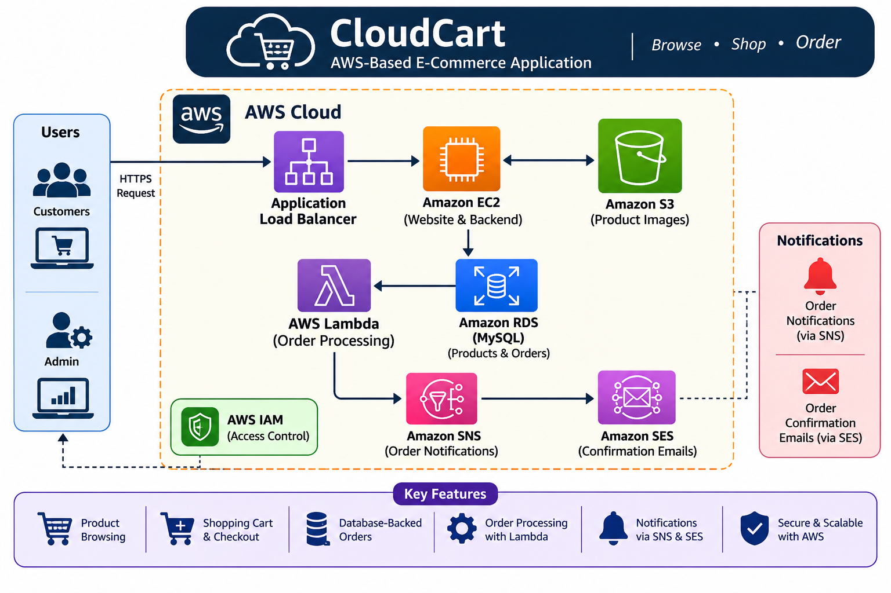
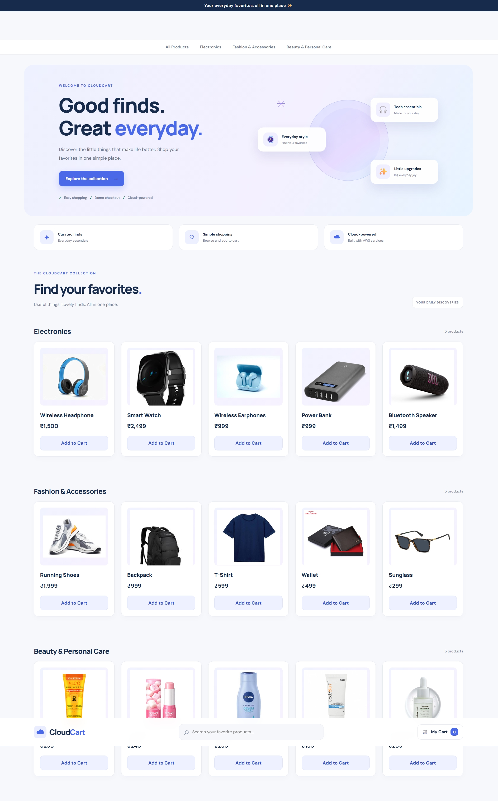
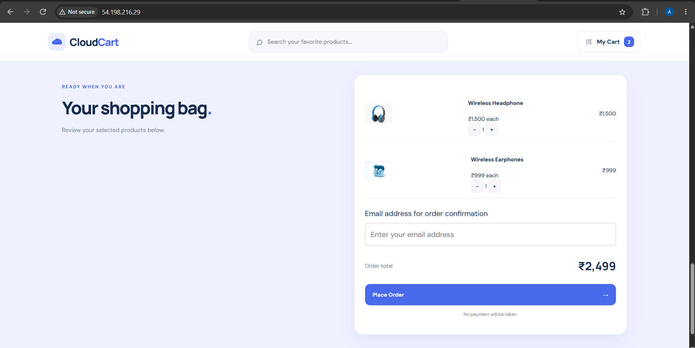
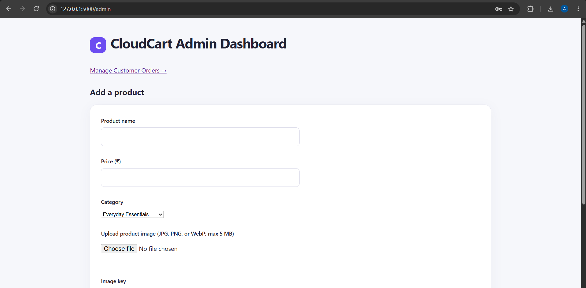
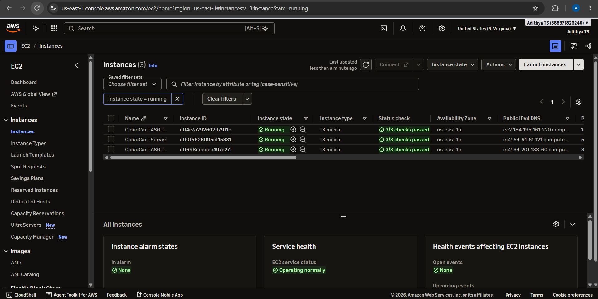

# 🛒 CloudCart
### Cloud-Based E-Commerce Platform | Built with Amazon Web Services

A cloud based e-commerce application featuring product management, shopping cart functionality, order processing and an administrative dashboard, powered by AWS infrastructure.

  

---

## 📌 About the Project

**CloudCart** is a cloud-based e-commerce platform developed to demonstrate the integration of application development with Amazon Web Services.

The platform provides a shopping experience where customers can browse products, manage their shopping carts and place orders. It also includes an administrative dashboard for managing product information and images.

The application uses AWS services for hosting, database management, image storage, order processing, notifications and infrastructure scalability.

## 🖥️ Application Preview

| Customer Homepage | Shopping Cart |
|:---:|:---:|
|  |  |

| Admin Dashboard | AWS EC2 Deployment |
|:---:|:---:|
|  |  |

## ☁️ Cloud Architecture & AWS Services

CloudCart uses multiple AWS services to support different parts of the application.

| AWS Service | Implementation |
|:---|:---|
| **Amazon EC2** | Hosts the frontend and Flask backend |
| **Amazon S3** | Stores product images |
| **Amazon RDS (MySQL)** | Stores product and order information |
| **AWS Lambda** | Handles order processing |
| **Amazon SNS** | Delivers order notifications |
| **Amazon SES** | Sends customer confirmation emails |
| **AWS IAM** | Controls access and service permissions |
| **Application Load Balancer** | Distributes incoming application traffic |
| **EC2 Auto Scaling** | Adjusts EC2 instance capacity based on demand |

## ⚙️ Technology Stack

**Frontend**
- HTML5
- CSS3
- JavaScript

**Backend**
- Python
- Flask
- Gunicorn

**Database**
- MySQL
- Amazon RDS

**Cloud & Infrastructure**
- Amazon Web Services
- EC2
- S3
- Lambda
- SNS
- SES
- IAM
- Application Load Balancer
- EC2 Auto Scaling

**Web Server**
- Nginx

## ✨ Core Features

- Product catalogue with product details and pricing.
- Shopping cart and checkout functionality.
- Order placement and order management.
- Administrative login and dashboard.
- Add, update and delete products.
- Product image uploads to Amazon S3.
- Persistent product and order storage using Amazon RDS.
- Automated order processing through AWS Lambda.
- Order notifications through Amazon SNS.
- Customer confirmation emails through Amazon SES.
- Load balancing and EC2 Auto Scaling.

## 🔄 Application Workflow

1. Customers access the CloudCart website.
2. The Application Load Balancer distributes incoming requests to EC2 instances.
3. Nginx forwards application requests to the Flask backend running through Gunicorn.
4. Product information is retrieved from Amazon RDS.
5. Product images are stored and accessed through Amazon S3.
6. When an order is placed, the backend invokes AWS Lambda for order processing.
7. Amazon SNS sends order notifications.
8. Amazon SES handles customer confirmation emails.

## 🏗️ Deployment & Infrastructure

The application is deployed on AWS using the following infrastructure:

- EC2 instances for application hosting.
- Nginx as a reverse proxy.
- Gunicorn as the Flask application server.
- Application Load Balancer for incoming traffic distribution.
- EC2 Auto Scaling for capacity management.
- Amazon RDS for database connectivity.
- IAM roles for AWS service permissions.

## 🔐 Security & Access Management

- IAM roles and permissions for AWS resource access.
- Private Amazon RDS database deployment.
- Environment variables for sensitive application configuration.
- Restricted administrative access.
- Security groups for controlling network traffic.

## 🚀 Future Improvements

- Customer registration and authentication.
- Online payment gateway integration.
- Order history and tracking.
- Product search and filtering.
- Enhanced monitoring and logging.

## 🎯 Project Objectives

- Gain practical experience with AWS cloud services.
- Understand cloud-hosted application architecture.
- Integrate a Python backend with managed AWS services.
- Implement serverless order processing.
- Explore load balancing and automatic scaling.
- Understand cloud security and IAM permissions.

## 👨‍💻 Author

**Adithya T S**

GitHub: [CloudCart – AWS E-Commerce Platform](https://github.com/adithyats11-wq/CloudCart-AWS-Ecommerce)

---

  <b>CloudCart — Bringing E-Commerce and Cloud Computing Together.</b>

